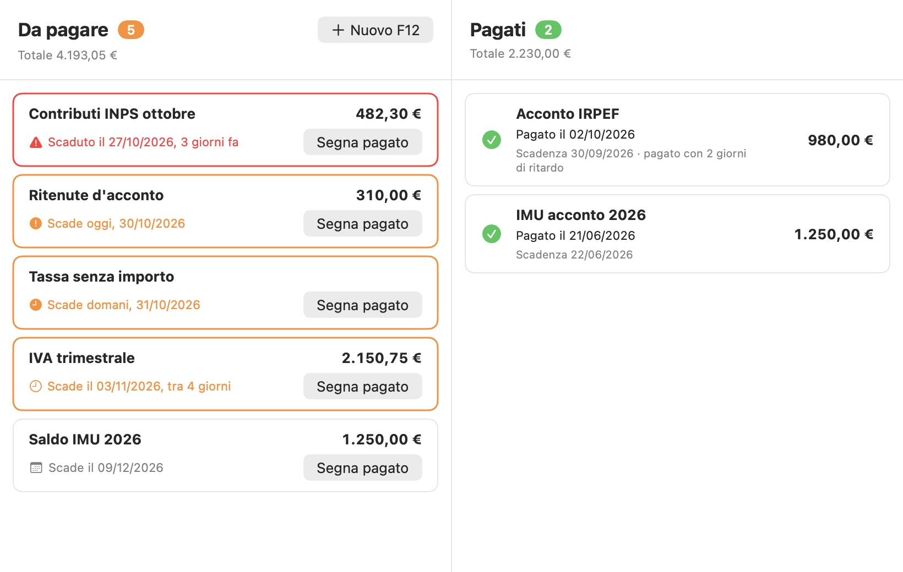

# Easy F24

Un gestionale semplicissimo per Mac per tenere traccia degli **F24**:

- a **sinistra** gli F24 **da pagare**, ordinati per scadenza (in rosso quelli scaduti, in arancione quelli che scadono entro una settimana);
- a **destra** gli F24 **già pagati**, con la data in cui sono stati pagati.



## Requisiti

- macOS 11 **Big Sur** o successivo
- Mac Intel oppure Apple Silicon (l'app è universale)

## Installazione

1. Scarica `Easy_F24.dmg` dalla pagina **Releases** del repository e aprilo con un doppio clic.
2. Nella finestra che si apre, trascina **Easy F24** sulla cartella **Applicazioni**, poi espelli il disco "Easy F24".
3. La prima volta: **tasto destro sull'app → Apri → Apri**.
   (L'app non è firmata con un certificato Apple a pagamento, quindi macOS chiede una conferma solo al primo avvio.)

## Come si usa

| Cosa vuoi fare | Come |
| --- | --- |
| Aggiungere un F24 | Pulsante **Nuovo F24** (oppure ⌘N): descrizione, importo (facoltativo) e scadenza |
| Segnare un F24 come pagato | Pulsante **Segna pagato**, poi la data del pagamento (di default oggi): clic sul campo data per aprire il calendario |
| Modificare un F24 | Doppio clic sulla scheda, oppure tasto destro → **Modifica…** |
| Rileggere importo e scadenza di un F24 arrivato da Gmail | Tasto destro → **Rileggi importo e scadenza dal PDF** |
| Eliminare un F24 arrivato da Gmail | Tasto destro → **Elimina…**: al controllo successivo viene riaggiunto (utile se lo elimini per sbaglio). Per toglierlo per sempre: **Elimina definitivamente…** |
| Annullare un pagamento | Tasto destro su un F24 pagato → **Riporta tra i da pagare** |
| Eliminare un F24 | Tasto destro → **Elimina…** |
| Prendere gli F24 dalle email del commercialista | Pulsante giallo **Collega a Gmail** in basso (vedi sotto) |

## F24 automatici da Gmail

Easy F24 può leggere la tua casella Gmail e aggiungere da solo gli F24 che ti manda il commercialista.

- Cerca **solo** le email del commercialista che hanno nell'oggetto **almeno una delle parole chiave
  scelte da te** (fino a 10, per esempio «MOD. F24», «Deleghe F24»; ricerca Gmail:
  `from:<commercialista> (subject:"MOD. F24" OR subject:"Deleghe F24")`).
  Maiuscole, minuscole, accenti e spazi non contano. Se lo studio ha un dominio proprio
  (es. `studio@studio-esempio.it`), di default accetta **qualsiasi indirizzo di quel dominio**, così arrivano anche
  gli F24 mandati dai colleghi; l'opzione si può spegnere. Per i provider pubblici (gmail.com, libero.it, PEC…)
  vale sempre e solo l'indirizzo esatto, perché lì chiunque può avere una casella.
- Ricorda l'**ultimo modulo trovato** (`ultimoModulo` in `gmail.json`): a ogni controllo aggiunge solo le email
  arrivate dopo. La prima volta prende solo il modulo più recente, per non riempire la lista con quelli vecchi.
- Dal PDF allegato legge l'**importo** (il «SALDO FINALE», anche scritto «264 00» con i centesimi in una
  casella a parte, o «totale da versare») e la **scadenza** («scadenza», «entro il…»). Li cerca nel testo
  del PDF, nei campi compilabili del modulo e, se il PDF è una scansione, con il riconoscimento del testo
  di macOS (OCR, sul Mac). La scadenza del PDF ha la precedenza su quella dell'email: con più rate ogni
  modulo ha la sua. Se un'email contiene più moduli PDF, ogni modulo diventa un F24.
- Se un importo o una scadenza non sono giusti, basta aprire l'F24 con un doppio clic e correggere.
- Controlla all'apertura dell'app, poi ogni 30 minuti e quando premi **Controlla ora**.
- **F24 eliminati per sbaglio:** a ogni controllo l'app confronta le email del commercialista trovate su
  Gmail (dalla prima importata in poi) con la lista e riaggiunge gli F24 che mancano: tra quelli
  **da pagare** se la scadenza non è ancora passata, altrimenti tra i **pagati** (con la scadenza come
  data del pagamento). Per restare leggera fa una sola ricerca che restituisce solo gli identificativi;
  ogni email viene scaricata una volta per sapere quanti F24 contiene e poi solo se ne manca qualcuno.
- L'accesso a Gmail è **in sola lettura**. La password di Google non passa mai dall'app: l'accesso si fa nel browser
  e l'app conserva solo un token nel **Portachiavi** di macOS.

### Prima configurazione (una volta sola)

Google chiede che ogni app che legge Gmail abbia delle proprie credenziali. Sono gratuite e si creano così:

1. Vai su [Google Cloud Console](https://console.cloud.google.com/) con il tuo account Google e crea un progetto
   (per esempio «Easy F24»).
2. In **API e servizi → Libreria** cerca **Gmail API** e premi **Abilita**.
3. Configura la **schermata di consenso OAuth** (nelle versioni più recenti: **Google Auth Platform**):
   tipo di utente **Esterno**, nome dell'app e la tua email. In **Utenti di test** (o **Pubblico**) aggiungi
   il tuo indirizzo Gmail.
4. In **Credenziali → Crea credenziali → ID client OAuth** (o **Client → Crea client**) scegli
   **App desktop** e scarica il file JSON.
5. In Easy F24 premi il pulsante giallo **Collega a Gmail** in basso a destra
   (una volta collegato diventa **Gmail…**, per cambiare le impostazioni):
   1. scrivi l'**email del commercialista** (se lo studio ha un dominio proprio, puoi accettare tutti i suoi indirizzi)
      e le **parole chiave** che il commercialista mette nell'oggetto delle email con gli F24
      (ne basta una per email; al massimo 10);
   2. premi **Importa file JSON…** e scegli il file appena scaricato (oppure incolla Client ID e client secret);
   3. premi **Accedi con Google…**: si apre il browser, scegli il tuo account e consenti l'accesso.

> **Nota sulla durata dell'accesso.** Finché l'app Google è in stato «Test», Google fa scadere l'accesso
> dopo 7 giorni e Easy F24 chiederà di ricollegarsi. Per evitarlo, nella schermata di consenso premi
> **Pubblica app** («In produzione»): al successivo accesso Google mostrerà l'avviso «app non verificata»;
> trattandosi della tua app, scegli **Avanzate → Vai a Easy F24**.

> Dopo un aggiornamento dell'app, macOS può chiedere una volta il permesso di usare la voce
> «Easy F24 – Gmail» del Portachiavi: scegli **Consenti sempre**.

## Sicurezza

**Cosa fa l'app per proteggerti**

- **Email false.** Il mittente di un'email si può falsificare. Easy F24 importa un'email solo se:
  l'indirizzo vero (non il nome visualizzato) è quello del commercialista o del dominio del suo studio, l'oggetto contiene
  una delle tue parole chiave e Gmail ha verificato che viene davvero dal suo dominio (SPF, DKIM o DMARC).
  Le email che non superano la verifica non vengono importate e sono segnalate in basso con uno scudo arancione.
- **Accesso a Google.** Si fa nel browser (OAuth con PKCE e controllo dello «state»): l'app non vede mai la password.
  Il permesso è di sola lettura e il token sta nel Portachiavi. **Scollega** revoca il permesso; si può revocare
  anche da [myaccount.google.com/permissions](https://myaccount.google.com/permissions).
- **Server locale per l'accesso.** Ascolta solo su `127.0.0.1` (non è raggiungibile da altri computer),
  accetta solo la risposta di Google e si chiude da solo dopo 5 minuti.
- **Rete.** Solo HTTPS verso Google, senza cache su disco né cookie: email, allegati e token non restano nella cache.
- **Allegati.** Vengono letti solo PDF (al massimo 10 per email e 10 MB ciascuno); le email in HTML non vengono
  mai mostrate, quindi niente immagini remote o pixel traccianti.
- **Sandbox di macOS.** L'app gira chiusa nella sandbox: può usare solo la propria cartella, collegarsi a Internet,
  ricevere il ritorno dal browser su `127.0.0.1` e leggere il file JSON che scegli tu con «Importa file JSON…».
  Non può leggere documenti, foto, email o dati di altre app. Il **runtime protetto** impedisce di iniettarle codice.
  I permessi sono in `Resources/EasyF24.entitlements`.
- **File.** La cartella dei dati è leggibile solo dal tuo utente (permessi 700, file 600).
- **Nessuna libreria esterna**: solo framework di Apple.
- **Download integro.** Ogni release riporta l'impronta SHA-256 dei file. Prima di aprire il .dmg puoi controllarla nel Terminale:

  ```bash
  shasum -a 256 ~/Downloads/Easy_F24.dmg
  ```

**Cosa resta da sapere**

- **Controlla sempre l'F24 prima di pagarlo.** La lista aiuta a non dimenticare le scadenze, ma importo e codici
  vanno verificati nel PDF. Un F24 si paga con il modello F24 (home banking, ufficio postale), mai con un bonifico
  a un IBAN: se un'email chiede altro o mette fretta, telefona al commercialista.
- **macOS Big Sur non riceve più aggiornamenti di sicurezza da Apple.** È il rischio principale del Mac del 2014:
  falle note del sistema (per esempio nella lettura di PDF o nel browser) restano aperte. Consigli: attiva
  **FileVault** (i dati dell'app non sono cifrati di per sé), attiva il firewall, usa un browser ancora aggiornato,
  non aprire allegati inattesi e, se possibile, usa un utente non amministratore.
- **L'app non è firmata con un certificato Apple (Developer ID) né notarizzata**: per questo macOS chiede conferma
  al primo avvio e non può garantire chi l'ha prodotta. Scarica solo dalla pagina Releases e controlla l'impronta SHA-256.
- **I PDF li legge macOS.** Una falla di Big Sur nella lettura dei PDF resterebbe sfruttabile, ma la sandbox ne limita
  i danni ai soli dati di Easy F24; in più vengono letti solo PDF di email verificate del commercialista.
- Se il commercialista usa una casella di un provider condiviso (per esempio @libero.it), la verifica conferma il
  provider, non la singola casella. Se invece le sue email vere vengono segnalate come «non verificate», il suo dominio
  non è configurato bene (SPF/DKIM): aggiungi l'F24 a mano e avvisalo.

## Dove sono salvati i dati

Tutto resta sul Mac, in un file leggibile. Per via della sandbox la cartella è dentro il «contenitore» dell'app:

```
~/Library/Containers/com.diegomustea.EasyF24/Data/Library/Application Support/Easy F24/f24.json
```

Chi aggiorna da una versione precedente alla 1.3 non deve fare nulla: al primo avvio macOS sposta da solo
la vecchia cartella `~/Library/Application Support/Easy F24` nel contenitore.

A ogni apertura dell'app viene fatta una copia di sicurezza in `f24-backup.json`, nella stessa cartella.
Nella stessa cartella `gmail.json` contiene l'email del commercialista e l'ultimo modulo trovato su Gmail;
le credenziali di Google stanno invece nel Portachiavi.
Per fare un backup basta copiare questa cartella.

## Compilare dal codice sorgente

Serve solo il pacchetto *Strumenti da riga di comando* di Apple (Xcode non è necessario):

```bash
xcode-select --install
```

Poi, dalla cartella del progetto:

```bash
./scripts/build.sh
```

Il risultato è in `build/`: `Easy F24.app`, il disco di installazione `Easy_F24.dmg` e `Easy_F24.zip`.
Su un Mac Intel si può compilare solo la versione Intel con `ARCHS=x86_64 ./scripts/build.sh`.

Per modificare il codice con Xcode basta aprire `Package.swift`.
L'icona si rigenera con `swift scripts/make-icon.swift`.

## Prove automatiche

```bash
./scripts/test.sh
```

Esegue le prove in `Tests/Prove.swift` con un Gmail simulato (nessun accesso alla posta vera):
lettura di importi e scadenze, ricerca e ultimo modulo, email false, accesso a Google, permessi dei file e calendario.

## Struttura

```
Sources/EasyF24/
  EasyF24App.swift   avvio dell'app
  ContentView.swift  finestra principale con le due colonne
  Righe.swift        schede "da pagare" e "pagato"
  Fogli.swift        finestre per aggiungere/modificare e per segnare come pagato
  Calendario.swift   campo data a tendina con il calendario grande
  F24.swift          il dato F24
  F24Store.swift     elenco degli F24 e salvataggio su file
  Formato.swift      date e importi all'italiana
  GmailSync.swift    ricerca delle email del commercialista e ultimo modulo trovato
  GmailAPI.swift     chiamate all'API di Gmail
  GoogleAuth.swift   accesso a Google (OAuth nel browser) e server locale per il ritorno
  LettoreF24.swift   importo e scadenza dall'email e dal PDF del modulo
  FoglioGmail.swift  impostazioni di Gmail e barra in fondo alla finestra
  Portachiavi.swift  salvataggio delle credenziali nel Portachiavi
  VerificaMittente.swift  controlli contro le email false (indirizzo, SPF/DKIM/DMARC)
  Rete.swift         connessione verso Google senza cache né cookie
Resources/
  EasyF24.entitlements        permessi della sandbox
  container-migration.plist   spostamento dei dati delle versioni precedenti nella sandbox
```

## Licenza

Easy F24 è distribuito con licenza **[Apache 2.0](LICENSE)** · Copyright 2026 Diego Mustea.

Puoi usare, modificare e ridistribuire il codice, anche per altri progetti, a queste condizioni:

- **le modifiche vanno segnalate**: chiunque, anche esterno al progetto, distribuisca una versione modificata
  deve indicare nei file cambiati che li ha modificati;
- vanno mantenuti l'attribuzione e il file [`NOTICE`](NOTICE), e inclusa una copia della licenza;
- il software è fornito «così com'è», senza garanzie.

Come segnalare le modifiche e proporre contributi: [`CONTRIBUTING.md`](CONTRIBUTING.md).
